

**UNIVERSITATEA ȘTEFAN CEL MARE DIN SUCEAVA**
**FACULTATEA DE INGINERIE ELECTRICĂ ȘI ȘTIINȚA CALCULATOARELOR**

# PROIECT DE DIPLOMĂ

## SenzorVital
### Arhitectură Multi-Senzor cu Analiză în Timp Real

| Conducător științific | Absolvent |
|---|---|
| Prof. Univ. Dr. Ing. Potorac Alin-Dan | Ghidoarcă Petru-Cristi |

**Suceava, 2025**

---

## Cuprins

- [Introducere](#introducere)
- [Capitolul 1 Proiectarea Sistemului IoT](#capitolul-1-proiectarea-sistemului-iot)
  - [1.1 Descrierea Sistemului IoT](#11-descrierea-sistemului-iot)
  - [1.2 Materiale Folosite](#12-materiale-folosite)
    - [1.2.1 Carcasele plăcilor](#121-carcasele-plăcilor)
    - [1.2.2 Plăcile ESP8266 CH340](#122-plăcile-esp8266-ch340)
    - [1.2.3 Plăcile ESP32-C3](#123-plăcile-esp32-c3)
    - [1.2.4 Senzori PIR de prezență](#124-senzori-pir-de-prezență)
    - [1.2.5 Senzori DHT11 de temperatură și umiditate](#125-senzori-dht11-de-temperatură-și-umiditate)
    - [1.2.6 Senzor de aburi](#126-senzor-de-aburi)
    - [1.2.7 Senzor de calitate a aerului](#127-senzor-de-calitate-a-aerului)
  - [1.3 Programe și protocoale folosite](#13-programe-și-protocoale-folosite)
    - [1.3.1 Tasmota](#131-tasmota)
    - [1.3.2 MQTT](#132-mqtt)
- [Capitolul 2 Configurarea Software](#capitolul-2-configurarea-software)
  - [2.1 Instalarea firmware-ului Tasmota](#21-instalarea-firmware-ului-tasmota)
  - [2.2 Configurarea senzorilor în Tasmota](#22-configurarea-senzorilor-în-tasmota)
  - [2.3 Setarea conexiunii de tip MQTT](#23-setarea-conexiunii-de-tip-mqtt)
- [Capitolul 3 Concluzii](#capitolul-3-concluzii)
- [Bibliografie](#bibliografie)

---

## Introducere

În această lucrare s-a încercat o analiză detaliată a realizării unei rețele de microcontrolere de tip ESP care sunt conectate la diferite tipuri de senzori și sunt configurate prin intermediul firmware-ului open-source Tasmota. Acest sistem IoT[^1] permite monitorizarea în timp real a parametrilor precum temperatura și umiditatea.

Realizarea sistemelor inteligente constă în utilizarea soluțiilor IoT ce au costuri reduse și sunt adaptabile pentru a răspunde cerințelor actuale de pe piață. Rețeaua de senzori propusă în această lucrare se încadrează în acest context deoarece s-au folosit componente accesibile ca preț și consum.

În componența acestei lucrări se arată potențialul de integrare de care poate da dovadă sistemul dezvoltat, dar și modularitatea lui, care permite scalarea și adaptarea soluției pentru diferite cazuri de utilizare. Prin folosirea firmware-ului Tasmota, sistemul are o mare comunitate de utilizatori și dezvoltatori activi, firmware-ul fiind întreținut și dezvoltat periodic.

Scopul lucrării este de a prezenta procesul de implementare a acestei rețele de senzori, de la selecția componentelor până la configurarea firmware-ului, acesta fiind axat pe particularitățile fiecărui senzor folosit și protocoale de comunicare folosite. De asemenea, lucrarea își mai propune totodată scoaterea în evidență a avantajelor folosirii unei arhitecturi bazate pe microcontrolere de tip ESP și a firmware-ului Tasmota în realizarea soluțiilor IoT.

Obiectivele specifice ale acestei lucrări sunt:

- Construcția microcontrolerelor de tip ESP în raport cu folosirea lor în rețeaua de senzori
- Observarea procesului de configurare a firmware-ului Tasmota pentru senzorii utilizați
- Validarea performanței și fiabilității de care poate da dovadă sistemul inteligent implementat
- Identificarea viitoarelor perspective în extinderea și îmbunătățirea soluției propuse

Acest sistem are în componența sa patru plăci ESP8266 cu chipset-ul CH340 și o placă ESP32-C3, acestea fiind conectate la senzorii de mișcare, de aburi, de calitate a aerului și de temperatură/umiditate. Acestea sunt configurate prin intermediul firmware-ului Tasmota, ce oferă un suport MQTT[^2] și prezintă o integrare cu sistemele de automatizare.

Prin abordarea acestui subiect, această lucrare are în vedere realizarea unui sistem IoT ce folosește protocolul de comunicație MQTT pentru a transmite datele preluate de la senzorii aferenți la un sistem care are instalat Home Assistant, ce oferă un model practic de implementare ce poate fi replicat și adaptat pentru diverse aplicații.

---

## Capitolul 1 Proiectarea Sistemului IoT

### 1.1 Descrierea Sistemului IoT

Acest sistem a fost realizat pentru monitorizarea locuinței, unde s-au folosit plăci de dezvoltare de tip ESP8266 CH340 și ESP32-C3 conectate la diverși senzori. Acestea sunt amplasate în carcase de protecție, realizate cu ajutorul unei imprimante 3D, și mai apoi au fost programate cu ajutorul firmware-ului Tasmota, ce permite o configurare mai ușoară și eficientă printr-o interfață web, iar comunicarea cu Home Assistant se realizează prin intermediul protocolului MQTT.

### 1.2 Materiale Folosite

În realizarea acestui proiect s-au folosit următoarele componente:

- Carcasele plăcilor de dezvoltare
- Plăci ESP8266 CH340
- Plăci ESP32-C3
- Senzori PIR de prezență
- Senzor de aburi
- Senzori DHT11 de temperatură
- Senzori de gaz

#### 1.2.1 Carcasele plăcilor

Aceste carcase s-au realizat cu ajutorul unei imprimante 3D. În cazul materialelor folosite în construcția acestor carcase, acestea pot fi făcute cu orice fel de filament, cu precizarea că acestea să fie concepute în așa fel încât senzorii să nu fie afectați de ele. Modelul 3D al carcasei prezentat în Figura 1 a fost preluat de pe MakerWorld[^3], fiind adaptat ulterior pentru componentele acestui proiect.

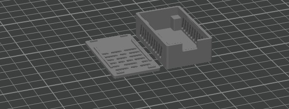

*Figura 1 Modelul 3D al machetei*

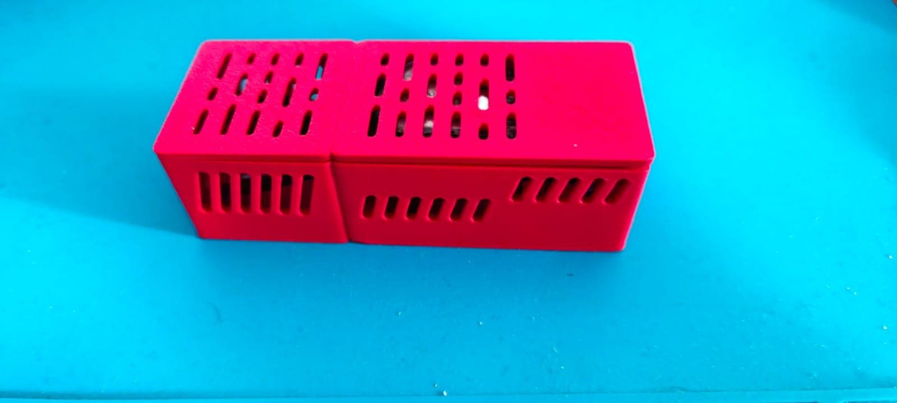

*Figura 2 Carcasa unei plăci*

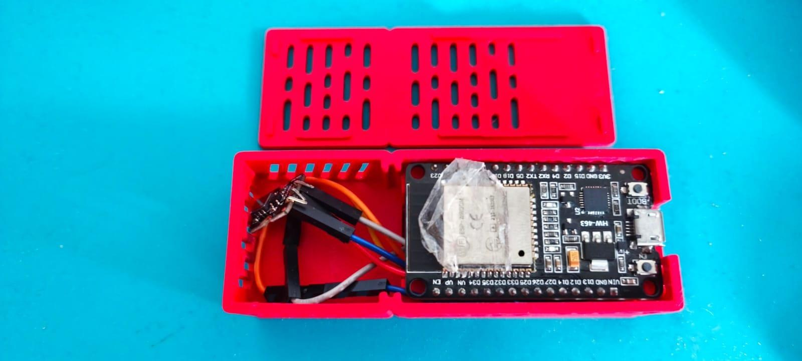

*Figura 3 Interiorul unei carcase*

#### 1.2.2 Plăcile ESP8266 CH340

Plăcile [1] ESP8266 cu chipset-ul CH340 sunt compacte și versatile, ceea ce le face perfecte pentru sistemele din zona IoT. Acestea au un procesor Tensilica Xtensa L106 și un microprocesor de 32 de biți de tip RISC[^4] ce funcționează la frecvențe de 80 și 160 MHz, asigurând funcționarea sistemelor de tip RTOS[^5].

Memoria lor internă are valori cuprinse între 128 KB RAM și 4 MB de memorie Flash. Modulul ESP-12E din componența acestora are tehnologie WiFi avansată, transformându-le în instrumente extrem de versatile pentru dezvoltatori.

Acestea se alimentează la tensiuni cuprinse între 4,5 V și 9 V, putând funcționa și la standardul de 3,3 V. Consumul de curent poate varia între 10 µA și 170 mA.

Modulul WiFi integrat permite realizarea a maxim 5 conexiuni de tip TCP simultane, iar interfața acestora este alcătuită din 17 pini GPIO[^6], multiplexor și un convertor analog-digital cu o rezoluție de 1024 de niveluri și rate de transfer de 110 Kbps și 460800 Kbps.

Tehnologia din componența procesoarelor acestora oferă un mediu de programare modern și intuitiv. Compatibilitatea cu instrumentele de dezvoltare precum Node.js accelerează procesul de prototipare și integrare.

Dimensiunile sale compacte de 49x24x13 mm îl fac o alegere bună pentru proiecte IoT de dimensiuni reduse, de la aplicații de automatizare și monitorizare până la dispozitive mobile cu conectivitate la o rețea wireless.

Aceste microcontrolere sunt utilizate la realizarea dispozitivelor de tip IoT, de la sisteme de rețea până la aplicații ce necesită interfețe multiple cu conectivitate WiFi și Bluetooth.

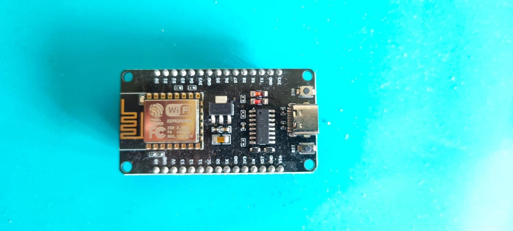

*Figura 4 ESP8266 CH340*

#### 1.2.3 Plăcile ESP32-C3

Placa de dezvoltare [2] ESP32-C3 reprezintă de asemenea o soluție potrivită pentru proiectele de tip IoT. Aceasta prezintă un procesor cu nucleu unic de tip RISC, având 32 de biți, ce poate rula la viteze de până la 160 MHz, putând rula un sistem RTOS și fiind optimizat pentru aplicații ce necesită consum redus de energie și performanță. Plăcuța are o memorie de 400 KB de SRAM și până la 4 MB de memorie Flash.

Acestea pot funcționa la tensiuni cuprinse între 3,0 V și 3,6 V, interfața de comunicare fiind compatibilă cu standardul de 3,3 V, și consumă doar 5 µA în repaus și până la 160 mA în sarcină maximă, fiind foarte eficiente din punct de vedere energetic și adecvate pentru dispozitive portabile sau aplicații care necesită un consum minim de energie.

ESP32-C3 poate fi conectată la rețeaua locală WiFi ce rulează pe banda de 2,4 GHz și Bluetooth pentru aplicațiile ce necesită conectivitate în rețea și prezintă 22 de pini GPIO, dintre care unii pot fi configurați să ruleze diverse funcții, de exemplu UART, SPI, I2C și PWM. Aceasta, ca și celelalte plăcuțe ESP, are în componența ei un convertor de tip analog-digital cu o rezoluție de până la 12 biți pentru citirea senzorilor analogici.

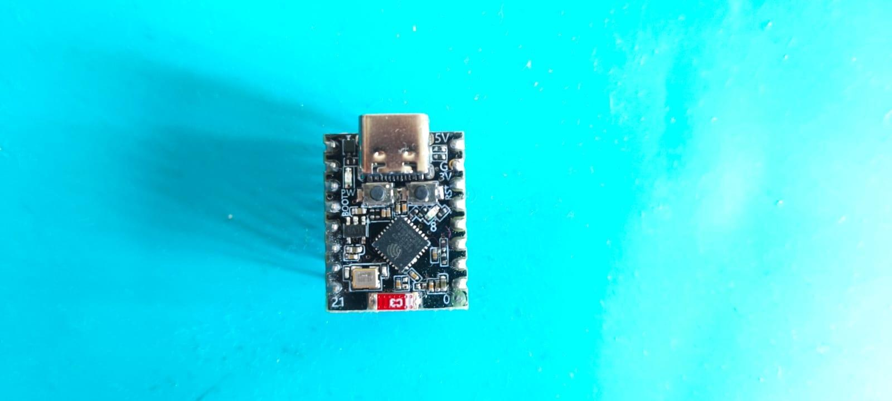

*Figura 5 ESP32 C3*

#### 1.2.4 Senzori PIR de prezență

Senzorii [5] PIR[^7] sunt specializați în detectarea mișcării prin recunoașterea schimbărilor de radiație a razei infraroșu din mediul extern. Aceștia sunt încapsulați pe un senzor piezoelectric ce răspunde la schimbările de temperatură provocate de corpurile aflate în mișcare.

Toate obiectele ce sunt mai calde decât temperatura de zero absolut pot emite o energie infraroșie nedetectabilă, fiind posibilă astfel detectarea ei de către acești senzori. Elementul sensorial este compartimentat în două jumătăți ce percep variațiile de radiație, ceea ce permite localizarea mișcării prin diferența de semnal pe care o au cele două arii.

Senzorii PIR pot funcționa la tensiuni cuprinse între 3.3 V și 5 V și sunt compatibili cu majoritatea plăcilor de dezvoltare existente pe piața actuală, de exemplu Arduino și ESP. Consumul lor energetic este extrem de scăzut și are valori ce variază între 65 µA în stadiul de repaus și 15 mA în timpul activării.

Raza de acțiune a unui senzor de tip PIR standard este cuprinsă între 3 și 7 metri, având un unghi de vizualizare de 110-120 de grade. Această valoare poate fi ajustată cu ajutorul potențiometrelor integrate în senzori pentru sensibilitate și timpul de întârziere, fiind posibilă personalizarea în funcție de necesitățile proiectului.

Interfața hardware este simplă, fiind prezent doar un pin de ieșire digital ce alternează între valorile LOW (0 V) și HIGH (3.3 V/5 V) în momentul în care se detectează activitate mobilă. Acest semnal poate fi conectat la microcontrolere pentru a activa diferite acțiuni.

Aceștia au un format compact, de obicei cu dimensiuni de 25x35x25 milimetri, ce face posibilă integrarea lor în diferite proiecte din zona IoT. Majoritatea senzorilor PIR prezintă în componența lor o lentilă Fresnel ce îmbunătățește câmpul de detectare.

Timpul de răspuns se încadrează între 0,5 și 2 secunde, iar aceștia au o stabilizare inițială la pornire de aproximativ 30-60 de secunde. Foarte mulți senzori permit modificarea acestei perioade pe durata mișcării.

Costul lor redus, combinat cu fiabilitatea și consumul lor scăzut, transformă senzorii PIR într-o componentă vitală pentru orice dezvoltator din domeniul IoT interesat de detectarea prezenței și mișcării în aplicațiile sale.

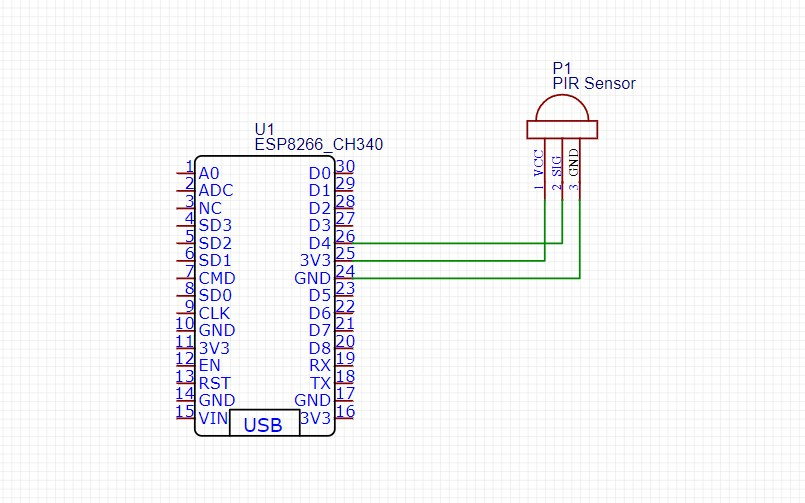

*Figura 6 Schema primei plăci ESP8266 CH340 cu senzorul PIR integrat*

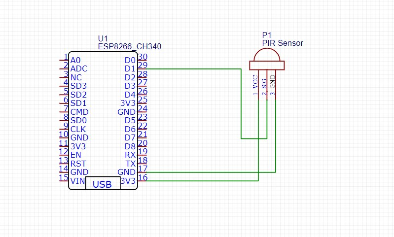

*Figura 7 Schema celei de a doua plăci ESP8266 CH340 ce are senzorul PIR integrat*

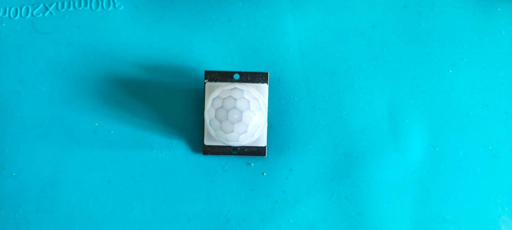

*Figura 8 Modul cu senzor PIR*

#### 1.2.5 Senzori DHT11 de temperatură și umiditate

Senzorii de tip [4] DHT11[^8] sunt folosiți la măsurarea umidității și a temperaturii din mediul extern. Utilizează un senzor de capacitate al umidității și un termistor, ambele legate la un microcontroler.

Principiul de funcționare al acestora este legat de principiul capacitiv pentru măsurarea umidității, în care un substrat special schimbă capacitatea electrică proporțional cu umiditatea detectată în aer. În cazul temperaturii, senzorul are în componență un termistor de tip NTC (cu coeficient negativ al temperaturii) cu o rezistență ce variază invers proporțional cu temperatura.

Aceștia pot opera la tensiuni cuprinse între 3,3 V și 5 V, fiind compatibili cu majoritatea platformelor de microcontrolere. Consumă puțină energie, aproximativ 2,5 mV atunci când se efectuează măsurători active și mai puțin de 100 µA în stand-by.

Aceștia pot măsura temperaturi cu valori cuprinse între 0 °C și 50 °C, având o precizie de ±2 °C, iar pentru măsurarea umidității aerului pot avea valori cuprinse între 20% și 90% RH (umiditate relativă), având o precizie de ±5% RH. Rezoluția măsurătorii pe care o are senzorul este de 1 °C pentru temperatură și de 1% RH pentru umiditate.

Comunicațiile acestora cu plăcile de dezvoltare ESP se realizează printr-un protocol de tip one-wire. Procesul necesită o sincronizare exactă, fiind prezente o multitudine de biblioteci software ce pot complica procesul de citire și de interpretare a informațiilor.

Senzorii pot avea dimensiuni de 15.5x12x5.5 milimetri, putând fi integrați și în proiecte mici. Aceștia conțin trei pini de conectare care sunt: VCC (alimentarea), GND (masa) și DATA (date de semnal).

Prețul accesibil, împreună cu ușurința utilizării și instalării, face ca senzorul DHT11 să fie o soluție optimă pentru aplicațiile ce nu necesită o precizie excesivă.

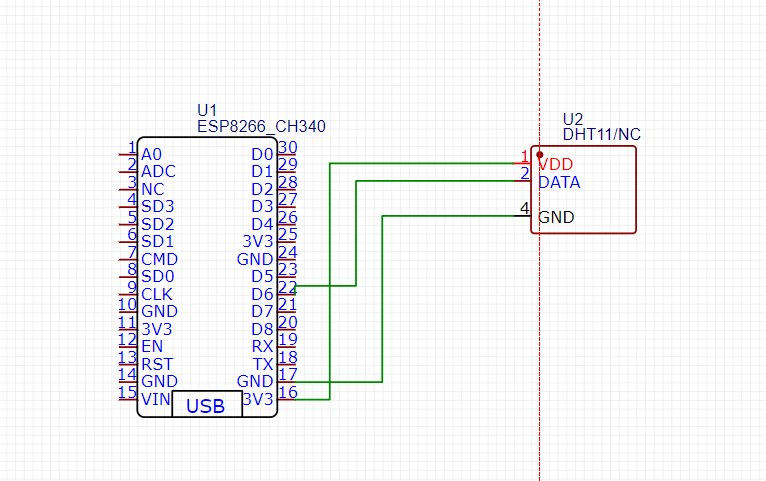

*Figura 9 Schema plăcii ESP8266 CH340 cu senzorul DHT11 integrat*

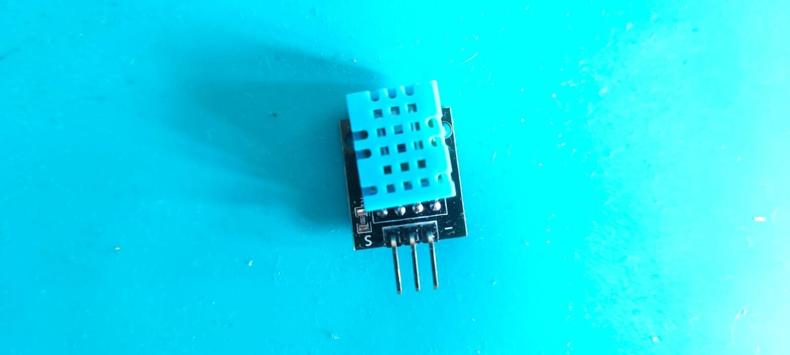

*Figura 10 Senzor de temperatură și umiditate*

#### 1.2.6 Senzor de aburi

Senzorii de aburi capacitivi sunt folosiți pentru determinarea exactă a prezenței și concentrației vaporilor de apă din aer. Aceștia sunt alcătuiți dintr-o placă de detecție cu un model special gravat realizat din materiale conductoare și dintr-un modul de procesare a semnalelor pentru interpretarea datelor. Cu cât crește concentrația aburului, se modifică capacitatea electrică în mod proporțional, aceasta fiind detectată și convertită într-un semnal electric.

Placa de detecție este acoperită cu un strat special anticoroziv ce îi asigură o durată de viață mai lungă în comparație cu alți senzori rezistivi obișnuiți.

Senzorii de aburi operează la tensiuni cuprinse între 3,3 V și 5 V și sunt perfect compatibili cu platforme de dezvoltare precum Arduino, ESP și Raspberry Pi. Consumul de energie este foarte redus și variază între 15 mA și 30 mA în regimul de funcționare și sub 5 mA în starea de repaus.

Modulul dispune de două tipuri de ieșiri: una analogică, cu valori ce variază proporțional cu gradul de aburi detectat, și una digitală (la modelele mai avansate), declanșată în momentul în care se atinge un prag prestabilit. Sensibilitatea și pragul de declanșare pentru ieșirea digitală se pot stabili prin intermediul unui potențiometru montat pe placa de control.

Interfața electronică simplă constă din 3-4 pini care sunt VCC (alimentarea), GND (masa) și OUT/SIG (ieșire analogică) și opțional DO (ieșire digitală). Configurarea presupune conectarea rapidă la orice microcontroler, creând o integrare imediată în diverse proiecte.

Dimensiunile pe care le poate avea acest modul sunt de 30x15 milimetri pentru circuitul de procesare și 60x20 milimetri pentru elementul senzorial.

Senzorul aferent este conceput pentru măsurători de lungă durată, putând suporta lipsa constantă de umiditate și alte elemente chimice din atmosferă.

Pentru modificări ample ale concentrației de aburi, timpul de răspuns este de aproximativ 1-2 secunde, pentru a asigura reacții rapide în aplicațiile de monitorizare și control.

Prețul accesibil, la care se adaugă precizia și fiabilitatea ridicată, face ca aceste module să fie puncte cheie pentru proiectele ce necesită monitorizarea constantă a vaporilor de apă.

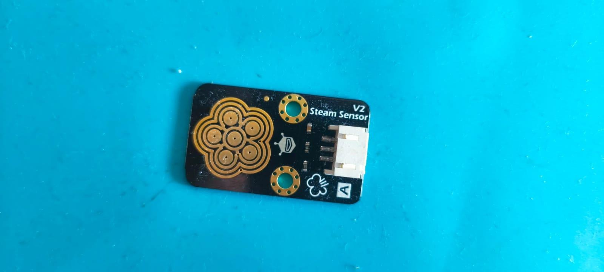

*Figura 11 Senzor de aburi*

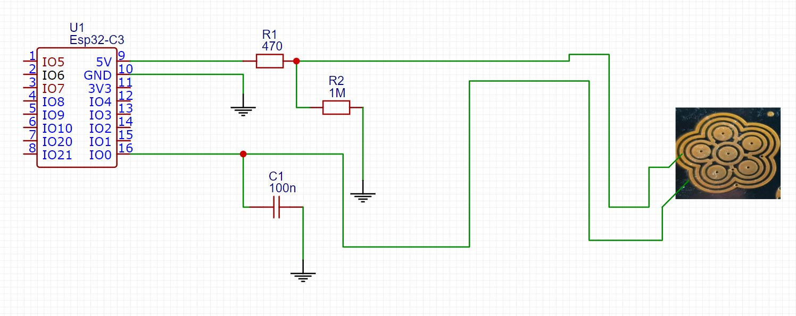

*Figura 12 Schema plăcii ESP32-C3 cu senzorul de detecție a aburilor integrat*

#### 1.2.7 Senzor de calitate a aerului

Senzorul DFRobot SEN0570 reprezintă un modul compact de calitate a aerului, conceput în mod special pentru monitorizarea parametrilor de mediu în aplicații IoT și de automatizare. Senzorul, pe lângă dimensiunile sale extrem de compacte (13x13x2.5 mm), are un consum redus de energie (<20 mA), ceea ce îl face perfect pentru dispozitivele portabile ce se alimentează prin intermediul unei baterii.

Acest senzor are o gamă de măsură cuprinsă între 10 ppm[^9] și 1000 ppm, acoperind spectrul complet de detectare a gazelor, fiind încadrate și concentrațiile periculoase ale aerului ce pot pune în pericol viața. Această flexibilitate permite funcționarea eficientă atât în aplicațiile de avertizare timpurie, cât și în sistemele de siguranță.

Așa cum a fost menționat la început, consumul energetic reprezintă unul dintre punctele forte ale acestui senzor. Tensiunea de alimentare a acestui senzor are o gamă între valorile 3.3 V și 5 V, ceea ce asigură compatibilitatea cu o gamă largă de microcontrolere și sisteme de dezvoltare.

Un alt avantaj de care dau dovadă acești senzori este generarea minimă de căldură, lucru ce permite integrarea senzorului în apropierea componentelor cu sensibilitate termică ridicată, fără riscul de interferență termică.

Durabilitatea reprezintă un alt aspect important al acestui senzor, acesta având o durată de viață estimată la aproximativ 5 ani în condiții normale de funcționare.

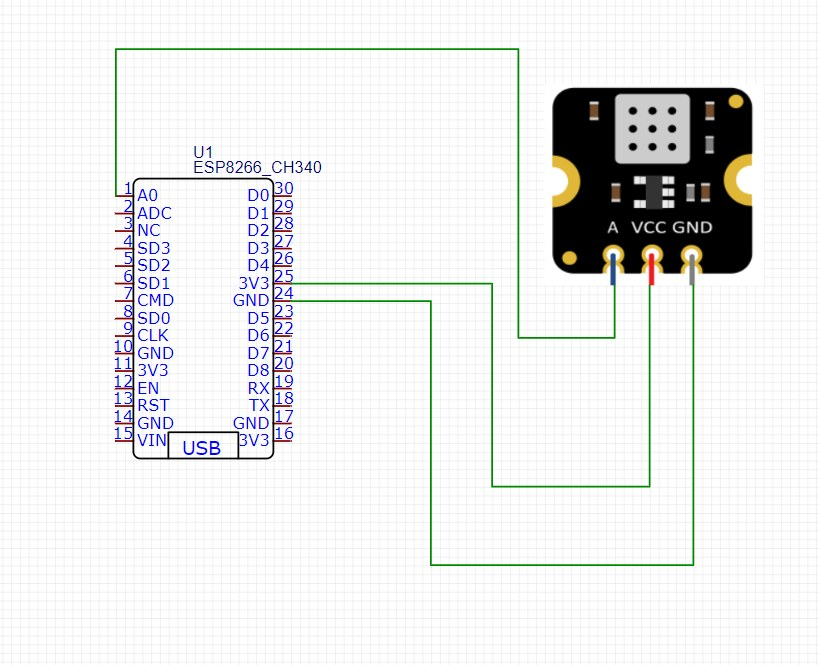

*Figura 13 Schema plăcii ESP8266 CH340 cu senzorul de detecție a calității aerului integrat*

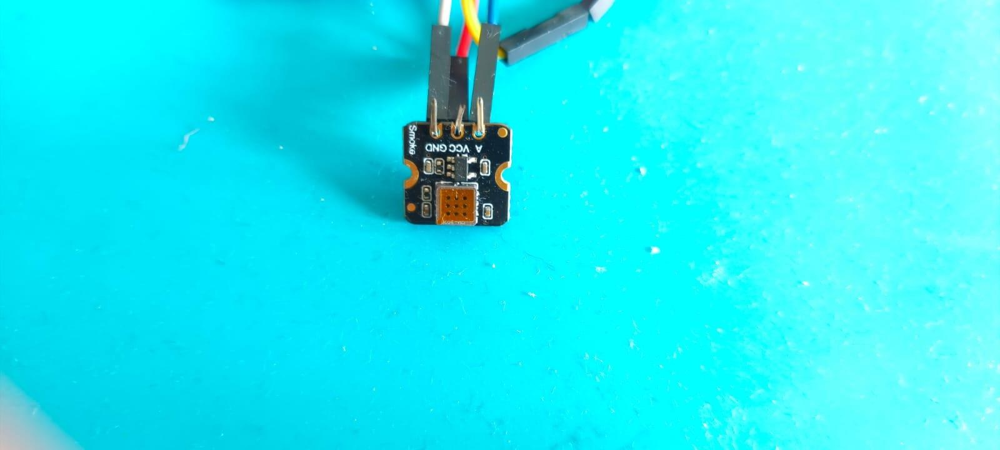

*Figura 14 Senzor de calitate a aerului de la DFRobot SEN0570*

### 1.3 Programe și protocoale folosite

În cadrul acestui sistem de tip IoT, pentru configurarea plăcilor de dezvoltare în raport cu senzorii aferenți s-a folosit firmware-ul Tasmota, iar pentru conexiunea acestora cu instanța de Home Assistant s-a utilizat protocolul de comunicare MQTT.

#### 1.3.1 Tasmota

[7] Tasmota este un firmware open source dezvoltat de Theo Arends în 2017, ce înlocuiește firmware-urile proprietare ale dispozitivelor IoT comerciale. Numele firmware-ului provine de la „Theo Arends Sonoff MQTT OTA"[^10], deși acum poate să suporte o varietate mai largă de dispozitive decât seria Sonoff inițială.

Principiul de funcționare al acestui firmware se bazează pe controlul local complet, eliminând dependențele de cloud și oferind transparență totală utilizatorilor, spre deosebire de soluțiile comerciale ce trimit datele către servere necunoscute.

Caracteristicile tehnice de care poate da dovadă acest firmware sunt:

- Rularea pe ESP8266/ESP32 cu arhitectură modulară
- Implementare robustă MQTT pentru integrarea cu Home Assistant, OpenHAB, Domoticz
- Suport pentru HTTP, WebSocket și protocoale proprietare
- Interfață web integrată pentru configurare și monitorizare
- Sistem de compilare flexibil pentru versiuni personalizate

Tasmota suportă sute de dispozitive, de la becuri LED până la controlere specializate. Acesta poate transforma complet funcționalitatea unui dispozitiv prin reprogramarea acestuia. De asemenea, oferă și funcționalități avansate, cum ar fi:

- Automatizarea locală cu reguli complexe
- Scripting în Berry (fiind inspirat din Python)
- Securitate WPA2/WPA3, SSL/TLS și actualizări OTA sigure

#### 1.3.2 MQTT

[6] [11] MQTT este un protocol de comunicație de tipul lightweight, dezvoltat în anul 1999 de IBM[^11] pentru monitorizarea oleoductelor prin satelit. Acesta a devenit un standard utilizat în realizarea ecosistemelor IoT, fiind simplu și eficient din punct de vedere energetic. A fost standardizat ISO[^12] în 2019 (MQTT 5.0).

MQTT folosește arhitectura publish-subscribe cu un broker central ce are rolul de a media comunicația:

- **Publisher** – publică mesaje către topic-uri
- **Subscriber** – se abonează la topic-uri pentru a primi mesaje
- **Broker** – reprezintă serverul central care rutează mesajele
- **Topic** – reprezintă canalul de comunicație cu structură ierarhică

MQTT prezintă trei nivele de garantare a livrării, care sunt:

- **QoS[^13] 0** („Fire and forget"): fără confirmare, cu posibilitatea de a pierde date
- **QoS 1** („At least once"): cu confirmare și cu posibilitatea de duplicare
- **QoS 2** („Exactly once"): livrare garantată unică și overhead maxim

Acest protocol are multiple straturi de protecție, care sunt:

- **Transport:** SSL/TLS, certificate X.509
- **Aplicație:** autentificare cu username/password, tokeni JWT
- **Rețea:** VPN, firewall, rate limiting

După standardizarea MQTT din 2019, acest protocol a căpătat niște funcționalități noi, care sunt:

- Request/Response pattern
- Shared subscription pentru load balancing
- Message expiry interval
- Enhanced authentication

MQTT servește ca un element fundamental pentru implementarea ecosistemelor de tipul IoT și reprezintă standardul de comunicare pentru miliarde de dispozitive conectate la nivel global, oferind eficiență energetică și fiabilitate pentru conexiuni instabile.

---

## Capitolul 2 Configurarea Software

### 2.1 Instalarea firmware-ului Tasmota

[8] Instalarea acestui firmware se poate face fie prin folosirea aplicației Tasmotizer, ce se poate descărca de pe GitHub la adresa <https://github.com/tasmota/tasmotizer/releases>, ori prin utilizarea instalatorului online Tasmota Web Installer, ce se poate accesa prin intermediul unui browser precum Chrome sau Edge.

În această lucrare s-a utilizat cea de-a doua metodă pentru instalarea acestui firmware. Pentru aplicarea acestei metode se accesează instalatorul online prin intermediul unui browser, accesând adresa <https://tasmota.github.io/install/>, și se poate observa interfața acestuia în captura de ecran din Figura 15.

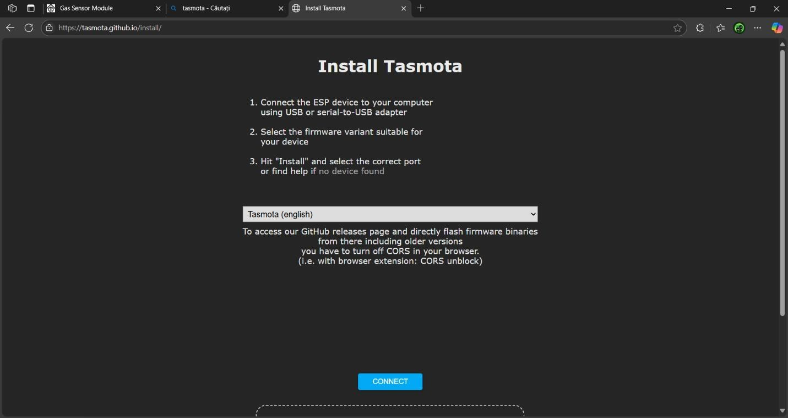

*Figura 15 Interfața Tasmota Web Installer*

În momentul în care a fost accesată această interfață, se apasă butonul CONNECT pentru a face conexiunea cu dispozitivul în cauză, care poate apărea într-un pop-up asemănător celui din Figura 16.

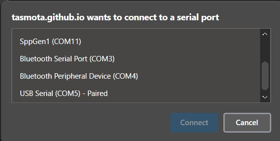

*Figura 16 Pop-up cu dispozitive ce pot fi tasmotizate*

După alegerea dispozitivului dorit, se apasă butonul Connect din pop-up, ceea ce duce din nou la deschiderea unui pop-up nou, asemănător celui din Figura 17.

*Figura 17 Pop-up Device Dashboard*

În pop-up-ul din Figura 17 se poate observa că se poate alege dintre două opțiuni. A doua opțiune oferă posibilitatea accesării consolei de comandă a dispozitivului ce are deja Tasmota instalat în componența sa, aceasta fiind reprezentată în Figura 18.

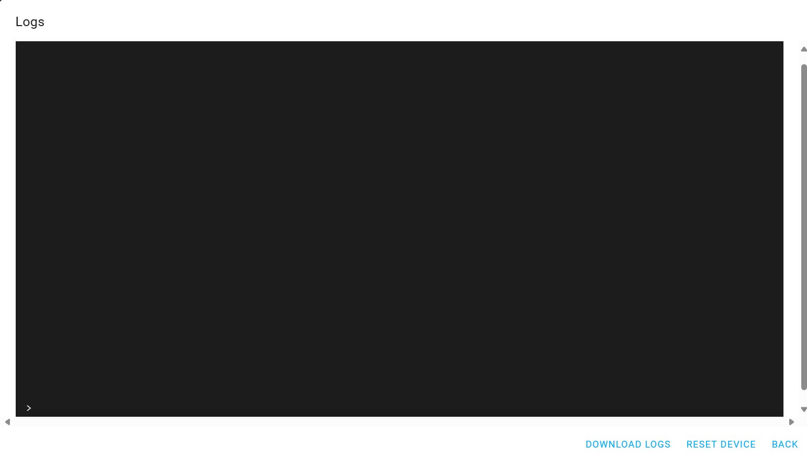

*Figura 18 Consolă de comandă Tasmota*

Prima opțiune deschide un nou pop-up asemănător celui din Figura 19, ce are opțiunea de ștergere totală a dispozitivului ce are deja instalat Tasmota, iar procesul de instalare se poate începe la apăsarea butonului NEXT. După instalarea programului, apare un nou pop-up ce are ca scop introducerea datelor de conectare la rețeaua locală de internet.

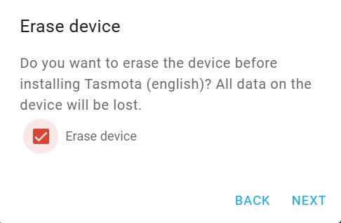

*Figura 19 Opțiunea de ștergere a dispozitivului*

### 2.2 Configurarea senzorilor în Tasmota

Procesul de configurare a senzorilor este asemănător pentru toate tipurile de senzori, fiind detectate diferențe în asignarea parametrilor și afișarea rezultatelor.

#### 2.2.1 Configurarea senzorilor PIR

După instalarea firmware-ului [10] Tasmota, interfața web a dispozitivului tasmotizat poate fi accesată prin intermediul unui browser, prin accesarea adresei sale IP (Internet Protocol). În cazul dispozitivului PIR1, interfața web a acestuia va fi asemănătoare celei din Figura 20.

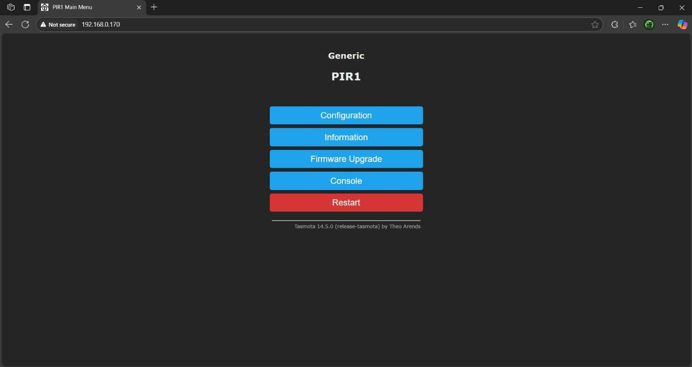

*Figura 20 Interfață Web PIR1*

Pentru realizarea configurării senzorului se va accesa butonul Configuration, pentru a ajunge la interfața din Figura 21.

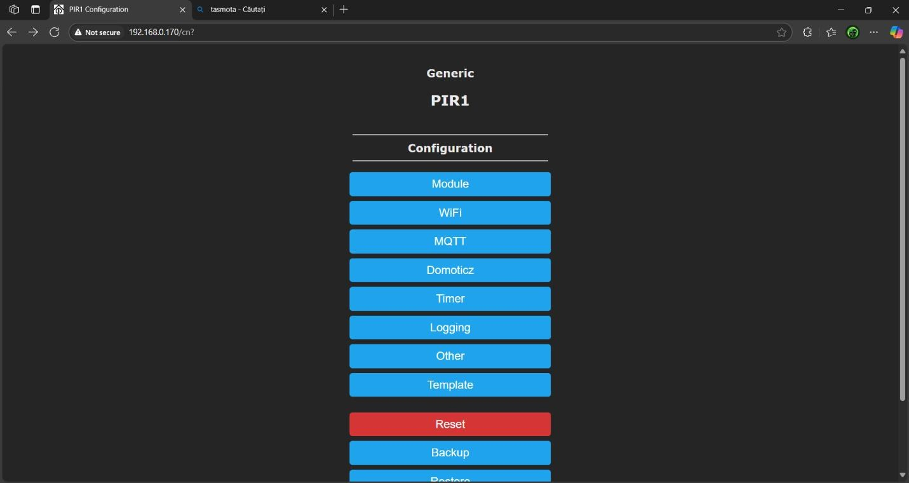

*Figura 21 Interfață pentru configurări în Tasmota*

Pentru configurarea senzorului în raport cu dispozitivul tasmotizat, se va accesa opțiunea „Module", ce redirecționează către o interfață asemănătoare celei din Figura 22, unde sunt realizate configurările necesare pentru dispozitivul PIR1, având valoarea Switch_n setată pe pinul D4.

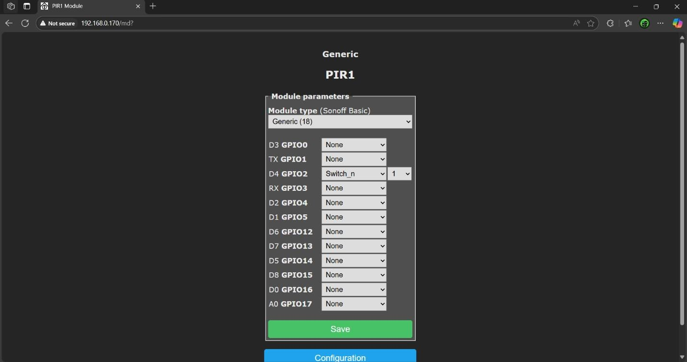

*Figura 22 Interfața Module parameters a dispozitivului PIR1*

În cazul dispozitivului PIR_Alarm, configurările necesare sunt reprezentate în Figura 23, având valoarea Switch setată pe D1.

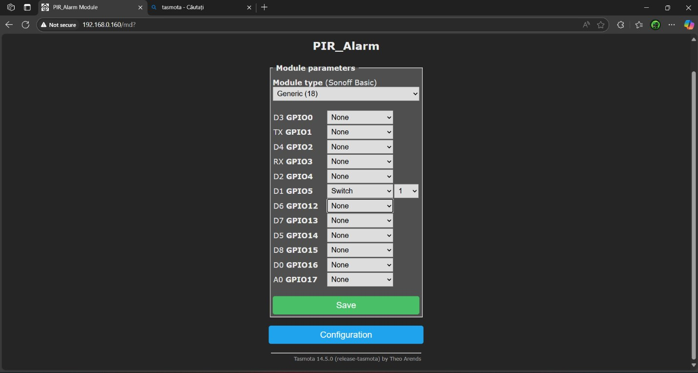

*Figura 23 Interfața Module parameters a dispozitivului PIR_Alarm*

#### 2.2.2 Configurarea senzorului DHT11 (Digital Humidity and Temperature) de temperatură și umiditate

În cazul senzorilor DHT11 (Digital Humidity and Temperature) de temperatură și umiditate, dispozitivul tasmotizat are setat pe pinul D6 parametrul DHT11, ceea ce reprezintă un parametru special conceput pentru asignarea senzorului DHT11. Se poate observa întreaga configurare a parametrilor în Figura 24.

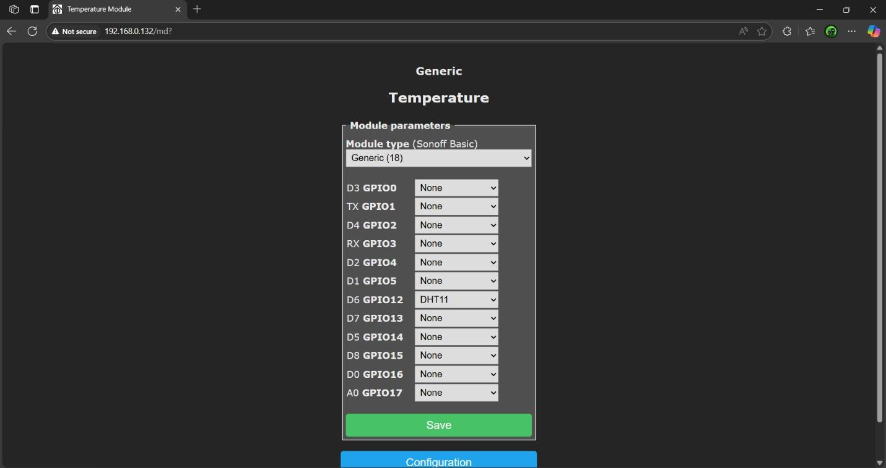

*Figura 24 Interfața Module parameters a dispozitivului Temperature*

În cazul acestui dispozitiv, interfața web a acestuia va prezenta date în legătură cu temperatura și umiditatea (Figura 25).

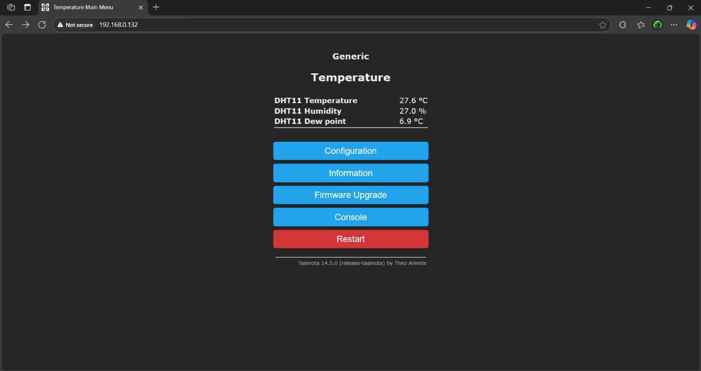

*Figura 25 Interfață Web Temperature*

#### 2.2.3 Configurarea senzorului de aburi

În cazul senzorilor de aburi, dispozitivul tasmotizat are setat pe pinul A0 parametrul ADC Input, iar valoarea Module type este setată pe ESP32C3 deoarece dispozitivul tasmotizat este un ESP32-C3. Se poate observa întreaga configurare a parametrilor în Figura 26.

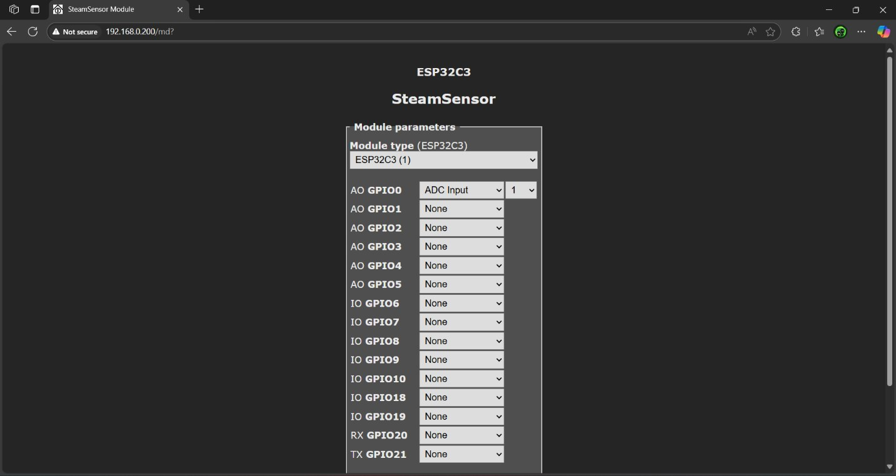

*Figura 26 Interfața Module parameters a dispozitivului SteamSensor*

În cazul acestui dispozitiv, interfața web a acestuia va prezenta date ce au în vedere concentrația de aburi din atmosferă (Figura 27).

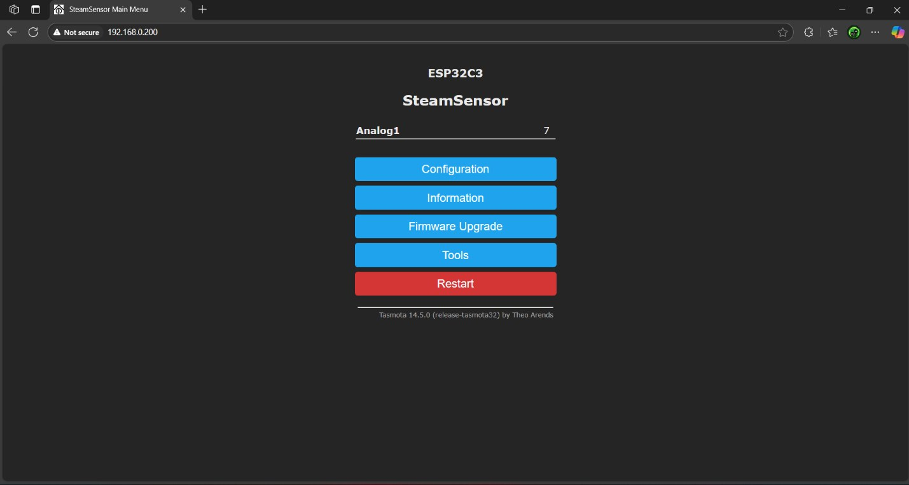

*Figura 27 Interfață Web SteamSensor*

#### 2.2.4 Configurarea senzorului de calitate a aerului

În cazul senzorilor de calitate a aerului, dispozitivul tasmotizat are setat pe pinul A0 parametrul „ADC MQ". Se poate observa întreaga configurare a parametrilor în Figura 28.

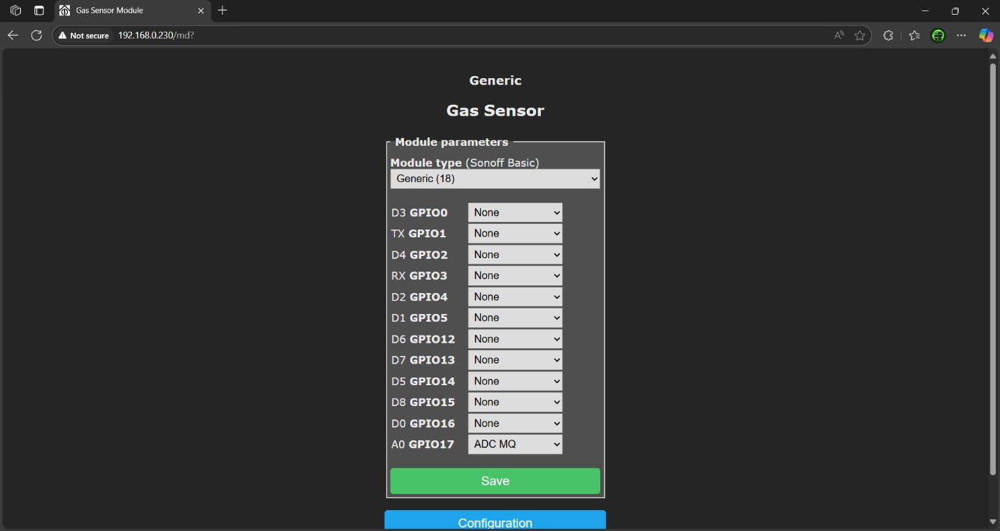

*Figura 28 Interfața Module parameters a dispozitivului Gas Sensor*

În cazul acestui dispozitiv, interfața web a acestuia va prezenta date ce au în vedere calitatea aerului (Figura 29).

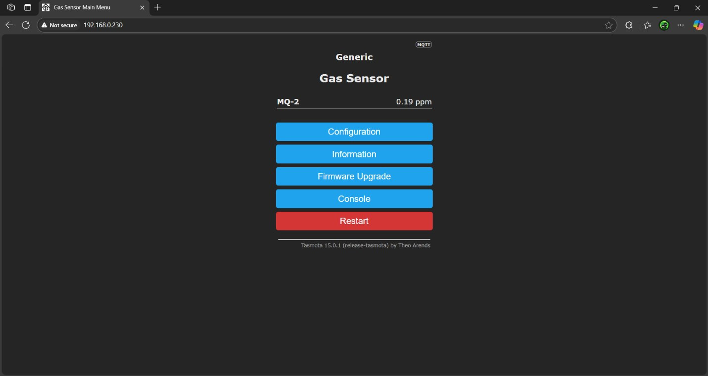

*Figura 29 Interfață Web Gas Sensor*

### 2.3 Setarea conexiunii de tip MQTT

În cazul conectării dispozitivelor tasmotizate cu instanța de Home Assistant prin intermediul protocolului de comunicație MQTT, setarea acestui tip de conexiune se realizează prin selectarea opțiunii MQTT din interfața de configurare. După selectarea acestei opțiuni, se va accesa interfața MQTT parameters, ce este reprezentată în Figura 30.

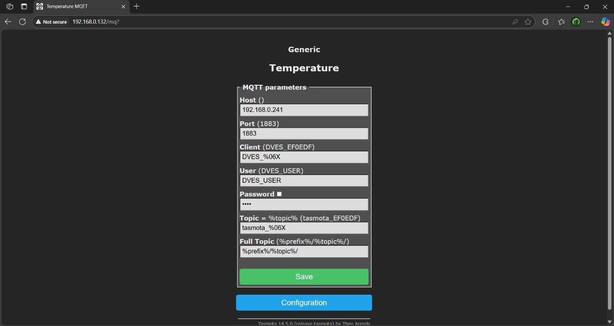

*Figura 30 Interfață MQTT parameters*

Cum se poate observa, în câmpul Host se va introduce adresa IP a instanței de Home Assistant, iar în câmpul Port se va introduce portul în care se va realiza conexiunea de tip MQTT.

Toate datele preluate de senzori vor putea fi salvate într-o instanță de [3] [9] Home Assistant.

---

## Capitolul 3 Concluzii

Proiectul SenzorVital reprezintă o soluție completă a tehnologiilor IoT pentru monitorizarea condițiilor mediului extern în cadrul unei locuințe sau a unei zone de lucru, demonstrând în același timp aplicabilitatea practică a tehnologiilor moderne în îmbunătățirea calității vieții de zi cu zi.

Motivația ce a stat în spatele alegerii acestui proiect a fost determinată de necesitatea unei soluții de monitorizare a mediului extern în contextul actual. Sistemul IoT SenzorVital răspunde unei nevoi reale prin punerea la dispoziție a unei soluții ușor de utilizat și adaptabile pentru monitorizarea factorilor critici de mediu în timp real. Mai mult decât atât, instanța de Home Assistant a demonstrat faptul că poate să asigure o platformă centralizată destinată gestionării datelor și automatizării proceselor, făcând astfel ca sistemul acesta să fie o alegere perfectă pentru utilizatorii finali, cât și pentru aplicațiile comerciale.

În cadrul proiectului a fost implementat cu succes sistemul IoT distribuit, format din patru module ESP8266 cu chipset-ul CH340 și un ESP32-C3, și totodată s-a demonstrat capacitatea de manipulare a mai multor dispozitive IoT într-o arhitectură coerentă folosind firmware-ul Tasmota. Integrarea senzorilor PIR pentru detectarea mișcărilor, DHT11 pentru monitorizarea temperaturii și a umidității, a senzorilor de aburi și de calitate a aerului pune la dispoziție o perspectivă comprehensivă asupra condițiilor din mediul extern. Acest sistem este compatibil cu sistemele de tipul Home Assistant, ce permit stocarea datelor, vizualizarea acestora prin interfețe intuitive și posibilitatea implementării de reguli de automatizare a locuinței.

Direcțiile de dezvoltare viitoare pe care le poate căpăta acest sistem pot fi:

- Integrarea de senzori suplimentari precum detectori de CO2, senzori de lumină ambientală sau monitoare de zgomot;
- Implementarea algoritmilor de machine learning pentru analiza predictivă a datelor colectate;
- Integrarea cu servicii cloud pentru backup-ul datelor și analize comparative pe termen lung.

---

## Bibliografie

1. Documentație tehnică și exemple de cod pentru microcontroller-ul ESP8266 – <https://www.esp8266.com/>
2. Specificații oficiale și documentație pentru ESP32-C3 – <https://www.espressif.com/en/products/socs/esp32-c3>
3. Documentația oficială Home Assistant – <https://www.home-assistant.io/docs/>
4. Fișa tehnică pentru senzorul DHT11 – <https://www.mouser.com/datasheet/2/758/DHT11-Technical-Data-Sheet-TranslatedVersion-1143054.pdf>
5. Tutorial pentru implementarea senzorilor de mișcare PIR – <https://learn.adafruit.com/pir-passive-infrared-proximity-motion-sensor>
6. Documentația protocolului MQTT – <https://mqtt.org/mqtt-specification/>
7. Documentația oficială Tasmota – <https://tasmota.github.io/docs/>
8. Instalarea Tasmota pe plăcuța ESP8266 – <https://tasmota.github.io/docs/Getting-Started/>
9. Integrarea Tasmota cu Home Assistant – <https://www.home-assistant.io/integrations/tasmota/>
10. Comenzi și configurații Tasmota – <https://tasmota.github.io/docs/Commands/>
11. MQTT Broker Mosquitto – <https://mosquitto.org/documentation/>

---

[^1]: IoT (Internet of Things) se referă la o rețea de dispozitive fizice conectate la internet care pot colecta, trimite și/sau primi date.
[^2]: MQTT (Message Queuing Telemetry Transport) este un protocol de mesagerie ușor și eficient, folosit pentru a face schimb de date între dispozitivele din cadrul unei rețele de tip IoT.
[^3]: Sursa: <https://makerworld.com/en/models/457564-esp-wroom-32-esp32-case?from=search#profileId-365558>
[^4]: RISC (Reduced Instruction Set Computer) – reprezintă o arhitectură de procesor ce are la bază un set de instrucțiuni simplu și eficient, fiind optimizat pentru viteză și consum de energie redus.
[^5]: RTOS (Real-Time Operating System) – reprezintă un sistem de operare proiectat să răspundă la evenimente în timp real.
[^6]: GPIO (General Purpose Input/Output) reprezintă o serie de pini dintr-un microcontroler sau microprocesor ce pot fi programați să citească datele de la senzori, butoane etc. sau să controleze diferite componente electrice, cum ar fi LED-uri, relee, motoare etc.
[^7]: PIR (Passive Infrared) reprezintă o serie de senzori care detectează mișcarea oamenilor sau a animalelor prin captarea variațiilor de radiație infraroșie (căldură) din mediul extern.
[^8]: DHT11 (Digital Humidity and Temperature version 11) reprezintă un senzor destinat măsurării temperaturii și umidității.
[^9]: ppm (parts per million) – este o unitate de măsură a concentrației, utilizată frecvent pentru a exprima cantități foarte mici.
[^10]: OTA (Over The Air) este un termen folosit pentru a face referire la o relație între dispozitive ce nu folosesc o conexiune fizică, ci o conexiune de tip wireless.
[^11]: IBM (International Business Machines Corporation) este una dintre cele mai vechi companii de tehnologie din lume, fiind fondată în 1911 (sub alt nume) și redenumită IBM în 1924.
[^12]: ISO (International Organization for Standardization) este o organizație independentă non-guvernamentală, fondată în 1947, care creează și publică standarde internaționale.
[^13]: QoS (Quality of Service) este un termen folosit în rețelistică și telecomunicații pentru a descrie mecanismele care asigură performanța rețelei pentru anumite tipuri de trafic.
